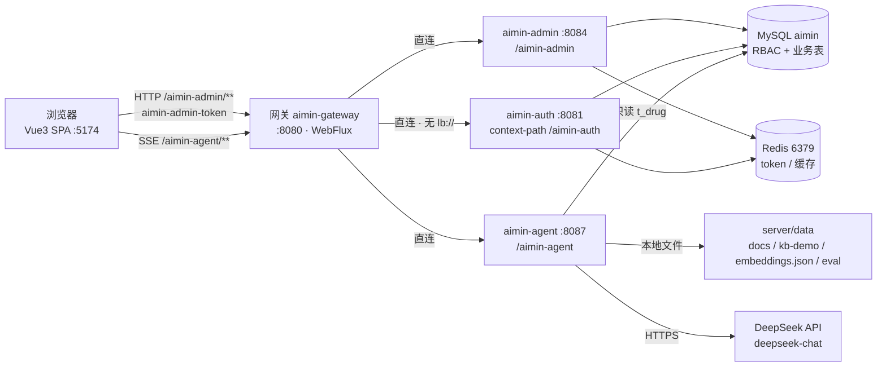
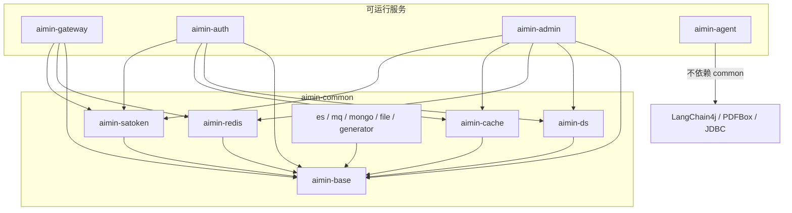
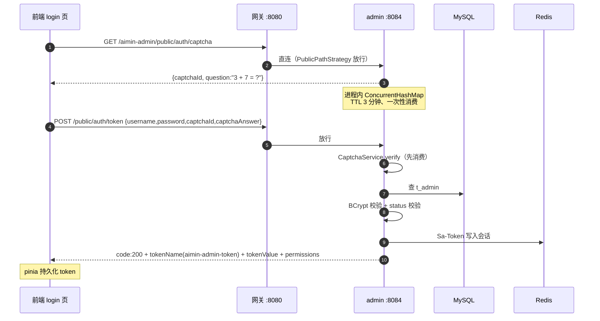
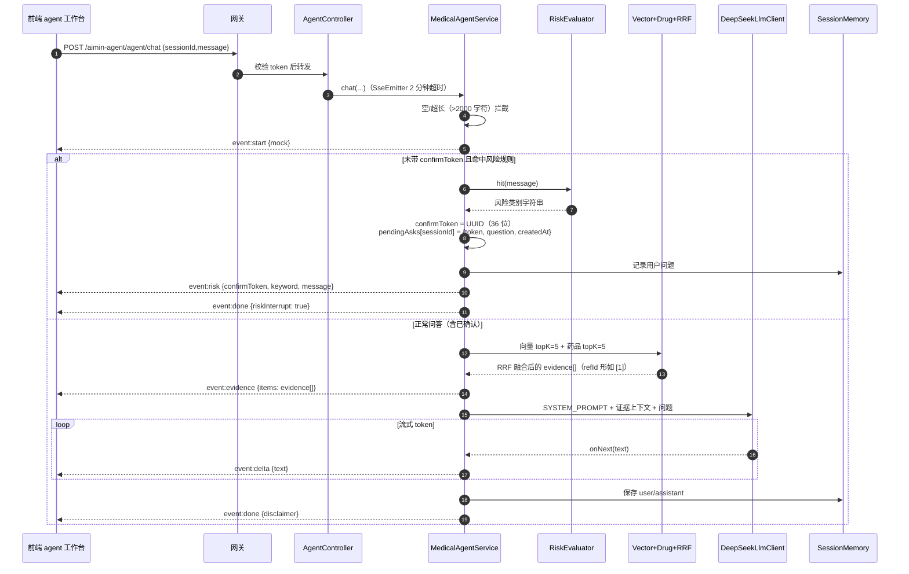
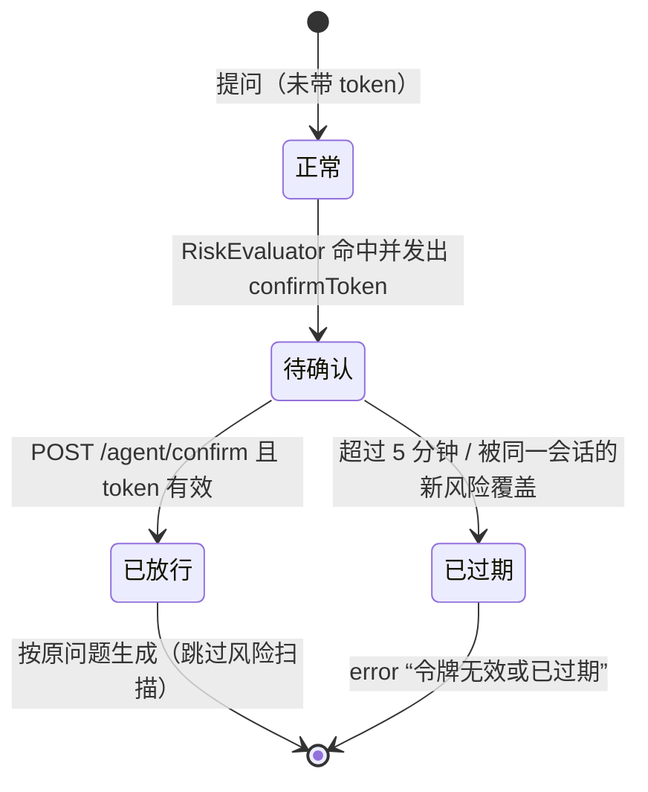
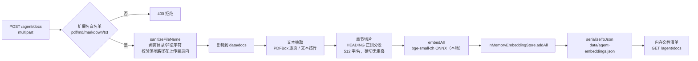
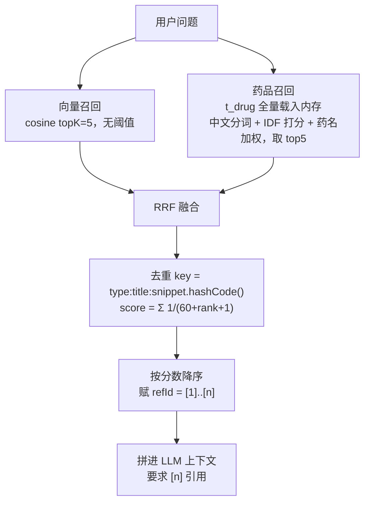

# aimin 项目架构说明（As-Built）

> 本文描述**当前代码实际运行形态**（2026-10-19，Phase 0+1 完成后）。
> 与 `server/docs/medical-agent-architecture.md`（目标方案，含 Redis Stack / 多模态 / 更完整的医疗数据模型）区分：那份是蓝图，本文是落地现状。
> 旧文档中的 `8085`、`5173` 是早期端口，**实际端口为 agent `8087`、前端 `5174`**，以本文为准。

---

## 1. 一句话定位

一个**医疗诊断 Agent 工作台**：管理端（Vue3）完成登录、知识库入库与运营管理；患者/医生侧通过网关调用 Agent 服务，走「意图 → 医疗风险两阶段确认 → 混合检索（向量 + 药品库）→ RRF 融合 → DeepSeek SSE 流式回答 → 证据引用」的链路。没有小程序端，`aimin-auth` 的微信登录当前不参与网页主流程。

**技术栈**

| 层 | 选型 |
|---|---|
| 语言/构建 | Java 21（`--enable-preview` 编译）/ Maven 多模块 |
| 后端框架 | Spring Boot 3.4.0、Spring Cloud 2024.0.0、Spring Cloud Alibaba 2023.0.1.0 |
| 网关/鉴权 | Spring Cloud Gateway（WebFlux/Netty）、Sa-Token 1.39.0 |
| 数据访问 | MyBatis-Plus 3.5.9、Druid、MySQL 8.x；Agent 侧仅用 `JdbcTemplate` 读药品表 |
| AI | LangChain4j 0.36.2（锁定版本）、DeepSeek OpenAI 兼容接口、本地 ONNX bge-small-zh 向量化 |
| 前端 | Vue 3.5 + Vite 6 + Element Plus 2.9 + Pinia 3（持久化）+ vue-router 4 + axios |
| 中间件 | MySQL（库 `aimin`）、Redis（6379）；**无 Nacos 的本地直连模式** |

---

## 2. 运行拓扑



要点：

- 网关是**唯一入口**，三条路由全部写死 `http://127.0.0.1:{8081,8084,8087}`；`SPRING_CLOUD_NACOS_DISCOVERY_ENABLED=false`、`CONFIG_ENABLED=false`。
- 网关只依赖 `aimin-redis`（Sa-Token 共享会话）与 `aimin-satoken`，不连 MySQL。
- **agent 不依赖 Redis、不依赖 Sa-Token**，只在网关层被鉴权；它自己持有一个仅指向 `t_drug` 的 `JdbcTemplate`。
- 四个进程都必须带 `--enable-preview` 启动，且显式设置 `SERVER__PORT`（防环境变量泄漏抢端口）。

---

## 3. 代码结构

```
aimin/
├── server/                          # ★ 后端 Maven 多模块（父 POM 在此）
│   ├── pom.xml                      # 版本管理 / Java 21 preview / 模块注册
│   ├── sql/                         # 全量建库脚本 + 增量加固脚本
│   ├── docs/                        # 架构目标方案（medical-agent-architecture.md）
│   ├── data/                        # Agent 运行时数据（见 §7）
│   │
│   ├── aimin-gateway/               # :8080 统一入口 + 鉴权 + CORS
│   ├── aimin-auth/                  # :8081 微信小程序登录（网页端暂不用）
│   ├── aimin-admin/                 # :8084 后台管理（RBAC / 菜单 / 科室 / 医生）
│   ├── aimin-agent/                 # :8087 ★ 诊断 Agent 全部逻辑
│   └── aimin-common/                # 公共组件库（10 个子模块）
│
├── admin-front/                     # ★ Vue3 管理前端
│   ├── vite.config.js               # /api、/public 代理到 8080，端口 5174
│   └── src/{api,router,store,layout,views,styles,utils}
│
├── 优化方案.md                       # 审计 27 项问题 + 分阶段整改记录
└── .mvn-offline-settings.xml        # 外网不可达时的离线 Maven 配置
```

### 3.1 后端模块职责

| 模块 | 端口/路径 | 职责 | 关键类 |
|---|---|---|---|
| `aimin-gateway` | 8080 | 统一路由、Sa-Token 全局过滤、CORS、默认拒绝 | `StrategyFactory`、`SaTokenConfigure`、`PublicPathStrategy`、`AdminPathStrategy`、`AgentPathStrategy`、`DenyPathStrategy` |
| `aimin-auth` | 8081 `/aimin-auth` | 微信 `code2session` 登录、`t_user_account` 用户账户 | `WxController`、`WxService`、`WxMiniprogramService` |
| `aimin-admin` | 8084 `/aimin-admin` | 管理端登录（算术验证码）、RBAC、动态菜单、科室/医院/医生管理 | `AuthController`、`AdminController`、`RouterController`、`AdminServiceImpl`、`CaptchaService` |
| `aimin-agent` | 8087 `/aimin-agent` | 诊断编排、检索、风险确认、流式生成、会话记忆、文档入库、离线评测 | `MedicalAgentService`、`RiskEvaluator`、`RrfFusion`、`IngestionService`、`EvaluationRunner` |
| `aimin-common` | — | 被上述服务依赖的公共库 | 见下 |

`aimin-common` 子模块：

| 子模块 | 内容 | 是否在运行链路 |
|---|---|---|
| `aimin-base` | `Result<T>`（`code/msg/data`，200/500）、全局异常、常量、`base.yml` | ✅ |
| `aimin-ds` | Druid + MyBatis-Plus 自动配置、`ds.yml` 连接模板 | ✅ admin/auth |
| `aimin-redis` | RedisTemplate 封装、`redis.yml` | ✅ admin/auth/gateway |
| `aimin-cache` | Caffeine / Spring Cache 封装 | ✅ admin/auth |
| `aimin-satoken` | `StpAdminUtil` / `StpUserUtil` 多账号体系、拦截器配置 | ✅ |
| `aimin-es` / `aimin-mq` / `aimin-mongo` / `aimin-file` / `aimin-generator` | 脚手架能力 | ❌ 未接入运行链路 |

模块依赖方向：



> agent 故意不依赖 `aimin-common`，避免把 admin 的数据源/鉴权约定带进诊断服务；它排除 `DataSourceAutoConfiguration`，自行构造药品库数据源。

### 3.2 agent 包结构

```
com.oimc.aimin.agent
├── AgentApplication              # 排除 DataSourceAutoConfiguration
├── config/AgentBeans             # embedding 模型 / 向量库 / LlmClient / 药品 JdbcTemplate
├── config/DemoSeedRunner         # @Order(1)，启动时把 data/kb-demo/ 灌入知识库
├── controller/AgentController    # chat / confirm / messages / docs（含 SSE 线程池）
├── service/MedicalAgentService   # ★ 编排核心
├── service/IngestionService      # PDF/MD/TXT → 切片 → 向量化 → 持久化
├── retrieval/VectorRetriever     # 向量召回
├── retrieval/DrugRetriever       # 药品库召回
├── retrieval/RrfFusion           # RRF 融合 + 引用编号
├── risk/RiskEvaluator            # ★ 硬编码医疗安全规则
├── memory/SessionMemory          # 进程内会话记忆（上限 40）
├── llm/{LlmClient,DeepSeekLlmClient,MockLlmClient}
├── eval/{EvaluationRunner,EvalQuestion}  # CLI 离线评测
└── model/{AgentEvent,ChatRequest,Evidence}
```

---

## 4. 核心链路

### 4.1 登录与鉴权



鉴权三道关：

1. **网关**：`StrategyFactory` 按路径返回策略，未登记路径落到 `DenyPathStrategy`（默认拒绝）。
   - `/aimin-auth/public/**`、`/aimin-admin/public/**` → 公开
   - `/aimin-admin/**` → `AdminPathStrategy`，`StpAdminUtil.stpLogic.checkLogin()`
   - `/aimin-agent/**` → `AgentPathStrategy`，同样校验 `aimin-admin-token`
   - 其余 → 拒绝
2. **admin 服务内**：`SaTokenConfigure` 拦截所有路径，仅排除 `/public/**`；`@SaCheckPermission(type = "ADMIN")` 必须显式带 `type = "ADMIN"`（默认 `StpUtil` 是另一套 token）。
3. **Agent 服务内无鉴权**：只信任网关转发，因此 agent 只绑本机并由网关暴露。

CORS 在网关统一处理：白名单默认 `http://localhost:5174,http://127.0.0.1:5174`（可用 `AIMIN_CORS_ORIGINS` 覆盖），允许 `aimin-admin-token` / `aimin-auth-token` / `Content-Type` / `Authorization`，OPTIONS 直接放行。

### 4.2 诊断对话（SSE 两阶段）



**确认后放行**：前端拿到 `confirmToken` 后调用 `POST /agent/confirm {sessionId, confirmToken}`，服务端 `peek` 校验 session+token，再以**原始问题**调用 `chat(..., confirmToken)`；`chat` 内 `consume` 移除待确认项、跳过风险扫描，重新检索并生成。确认接口**没有“拒绝/取消”分支**——用户只能选择继续或直接不点。`/agent/chat` 本身也接受 `confirmToken`，效果相同。

**SSE 事件协议**（`AgentEvent` 的 `data` 是 `Map<String,Object>`）：

| 事件 | data 字段 | 前端处理 |
|---|---|---|
| `start` | `mock`（boolean） | 初始化助手气泡，显示「演示模式」 |
| `evidence` | `items`（`Evidence[]`：`refId/type/title/page/snippet/score`） | 渲染证据卡（知识库/药品库标签） |
| `delta` | `text` | 打字机追加，Markdown 渲染 |
| `risk` | `confirmToken`、`keyword`、`message` | 渲染琥珀色确认卡，锁定发送 |
| `done` | `disclaimer`，风险中断时为 `riskInterrupt: true` | 结束流，展示免责声明 |
| `error` | `message` | 显示错误并解锁输入 |

**风险确认（第二段）**：



实现约束（`MedicalAgentService`）：

- `PENDING_TTL_MS = 5 * 60_000L`；`MAX_PENDING = 2_000`；`MAX_MESSAGE_CHARS = 2_000`。
- 待确认表是 `Map<sessionId, PendingAsk(token, question, createdAt)>`：**每个会话只保留一条**，新的风险问题会覆盖旧的；超过 2000 条时先清理过期项。
- token 绑定**原问题**：confirm 时忽略客户端传入的 `message`，用 `pendingAsks` 里的问题生成，防换题绕过；消费用 `peek` 校验后 `remove(key, value)`，错误 token 不会销毁正确待确认项，重复确认只会得到「令牌无效或已过期」。
- 已确认分支**不重新跑** `RiskEvaluator`，也**不追加**输出侧剂量警告（确认即视为已授权）。
- 会话记忆 `SessionMemory`：`ConcurrentHashMap<sessionId, Deque>`，每会话上限 40 条，进程重启即丢；**当前只用于历史查询/记录，未拼进 LLM 提示词**，因此多轮上下文实际不生效。

### 4.3 知识入库



- 上传大小上限 50MB（`spring.servlet.multipart.max-file-size`）。
- 白名单之外一律拒绝；文件名清洗会阻止 `../` 路径穿越。
- 向量库为 `InMemoryEmbeddingStore` + 启动时从 JSON 反序列化；`DemoSeedRunner` 在启动时把 `data/kb-demo/` 的 25 篇演示文档灌入（`aimin.seed-kb.enabled=false` 可关）。
- 设计上预留了 `aimin.agent.vector-store: redis` 开关，但当前只有 memory 实现。

### 4.4 混合检索与 RRF



- 向量侧 `EmbeddingSearchRequest(query, topK, null, null)`：**没有 minScore**，永远返回 topK，低相关证据也可能进入上下文。
- 药品侧不是 SQL LIKE：首次查询把 `t_drug` 中 `status=1` 且未删除的记录整表载入内存（`AtomicReference` 缓存），用 `ChineseTokenizer` 分词后做 IDF 加权词频打分，并按「药名完整出现 +8 / 通用名 +6 / 名称包含 +4」加权；`refresh()` 才会失效重载。
- RRF 常数 `K = 60`，两路权重相同；引用编号在融合后统一分配为 `[1]`、`[2]`…

### 4.5 医疗风险规则（合规底线）

`RiskEvaluator` 完全硬编码、不经过提示词，命中任一类别即中断进入两阶段确认：

| 类别（返回字符串） | 触发词示例（非全量） |
|---|---|
| 剂量与用法 | 剂量、用量、用法、服法、怎么吃/服用、吃多少、几片、一天几次、频次、间隔多久 |
| 处方与给药操作 | 处方、开药、开点药、配药、静滴、输液、注射、打针、手术、插管、麻醉、透析 |
| 剂量调整与过量 | 停药、加量、减量、过量、超量、中毒、吃多、多吃了、overdose |
| 联合用药 | 配伍、联合用药、一起吃/服、同服、相互作用、相冲 |
| 特殊人群与肝肾功能 | 孕、妊娠、哺乳、备孕、儿童、小儿、婴幼儿、新生儿、老人、肝功能、肾功能、肝/肾损伤 |

另有一个输出侧正则 `OUTPUT_DOSE`（`数字 + mg/g/ml/μg/iu/片/粒/袋/支/滴/单位`），在流式生成**结束后**检查；未确认的问题若回答中出现具体剂量，会追加一条“请核对说明书”的提示（已确认的问题跳过）。免责声明固定输出，不可关闭。

### 4.6 离线评测

```bash
java --enable-preview -jar aimin-agent.jar --aimin.eval.enabled=true
```

`EvaluationRunner`（`@Order(2) ApplicationRunner`，`aimin.eval.enabled=true` 时启用）读取 `data/eval/questions.json`，按 `fact / risk / drug / unanswerable` 四类计算：

- 事实类：Recall@5、MRR
- 药品类：药品命中率
- 风险类：风险识别准确率
- 不可回答类：拒答率

结果打印并写入 `data/eval/latest.json`，默认跑完退出（`aimin.eval.exit=true`）。

---

## 5. 前端架构

```
admin-front/src
├── main.js                 # ElementPlus + pinia + router + 图标全量注册
├── router/index.js         # 静态路由 + 登录守卫；动态路由由 store/route 合并
├── store/                  # user(token, permissions) / route(动态菜单) / app(loading)
├── api/                    # auth.js / agent.js(SSE) / system/*
├── utils/request.js        # axios 实例 + 拦截器（401 清 token）
├── utils/dynamicRoutes.js  # 后端菜单 → vue-router 注册/重置
├── layout/index.vue        # 毛玻璃侧栏 + 顶栏，菜单由 router.getRoutes 生成
├── styles/index.scss       # 全局主题（#0A84FF / 12px 圆角 / EP 变量覆盖）
└── views/
    ├── login/              # 算术验证码登录
    ├── agent/              # ★ 诊断工作台（三栏）
    ├── knowledge/          # 知识库上传 + 文档列表
    ├── dashboard/          # 首页
    ├── system/             # 管理员/菜单/角色
    ├── doctor/             # 医院/医生
    └── operations/         # 运营页
```

**路由**：`/login`、`/`（Layout，含 `/dashboard`、`/agent`、`/knowledge`）、`/404`；守卫无 token 跳登录。后端 `/aimin-admin/routers` 返回菜单树，前端 `dynamicRoutes.js` 转换成路由并 `addRoute`，同时写入 pinia（持久化）。

**请求层**：

- `utils/request.js`：`baseURL = import.meta.env.VITE_API_BASE_URL`（`.env.development` 为 `http://localhost:8080/aimin-admin`），自动带 `aimin-admin-token`；401 统一清 token 并单例提示。
- `api/agent.js`：`API_BASE = VITE_API_PREFIX || '/api'`，请求路径为 `/api/aimin-agent/...`；用 `fetch` + `ReadableStream` 手工解析 `data:` 行（SSE over POST），支持 `AbortController` 中断；上传用 `FormData`。
- Vite 代理：`/api` → `http://localhost:8080` 并**去掉 `/api` 前缀**；`/public` → 网关原样转发。生产环境需由 nginx/网关提供同等的 `/api` 转发（仓库未内置 nginx 配置）。

**诊断工作台三栏**：

1. 左：会话列表（本地内存，刷新即新会话）+ 新建/切换。
2. 中：消息流、证据卡、风险确认卡、免责声明、快捷问题、输入框（`streaming` 时禁用发送，可中断）。
3. 右：会话信息/患者档案占位（真实患者数据尚未接入）。

---

## 6. 安全设计

| 层 | 措施 |
|---|---|
| 入口 | 网关白名单路由；未匹配路径默认 `DenyPathStrategy`；CORS 仅本地来源、带凭证 |
| 身份 | Sa-Token 双账号体系（admin/user）；admin 登录 BCrypt、状态校验、验证码一次性 |
| 验证码 | 本地算术题，`SecureRandom`，TTL 3 分钟，进程内 Map（非 Redis），答案 `trim` 后按整数比较、先消费后校验密码 |
| 服务内 | admin 除 `/public/**` 全部要求登录；权限注解显式 `type="ADMIN"` |
| Agent | 网关 token 校验；消息长度上限 2000；confirmToken 为 UUID（36 位）、5 分钟、绑定问题、按会话原子消费、pending 上限 2000 会话 |
| 文件 | 扩展名白名单 + 文件名清洗 + 落地路径必须位于上传目录内；50MB 上限 |
| 医疗 | 硬编码风险规则不可提示词绕过；输出侧剂量检查；固定免责声明；两阶段确认后才给用药建议 |

**已知边界**：agent 服务本身不校验 token（信任网关；`application.yml` 未限制 `server.address`，直接访问 8087 即无鉴权）；验证码/会话/待确认风险/文档清单都是进程内状态，多实例部署会失效；网关只做登录校验，细粒度权限在 admin 的注解上。

---

## 7. 数据架构

### 7.1 MySQL（库 `aimin`，16 张表）

| 域 | 表 |
|---|---|
| RBAC | `t_admin`、`t_role`、`t_permission`、`t_role_permission`、`t_admin_role` |
| 组织 | `t_department`、`t_admin_department`、`t_doctor`、`t_hospital` |
| 药品 | `t_drug`、`t_drug_category`、`t_drug_img` |
| 其他 | `t_dict`、`t_evaluation`、`t_service`、`t_user_account` |

> 目标方案里的 `medical_document` / `consult_session` / 患者档案表**尚未落地**；知识文档、会话、待确认风险都在 agent 本地/内存。

### 7.2 Agent 本地数据

```
server/data/
├── docs/                      # 上传文档原件（运行时生成）
├── kb-demo/                   # 25 篇演示知识（高血压/糖尿病/血脂/抗凝/儿科/妊娠/肝肾/相互作用…）
├── agent-embeddings.json      # 向量库全量序列化（含 .bak-20261019 备份）
└── eval/{questions.json,latest.json}
```

### 7.3 Redis

仅 admin/auth/gateway 使用：Sa-Token 会话、Spring Cache、业务缓存。**验证码不在 Redis**。

### 7.4 进程内状态

| 状态 | 位置 | 生命周期 |
|---|---|---|
| 待确认风险 | agent `Map<sessionId, PendingAsk>`（≤2000 会话，每会话 1 条） | 5 分钟 / 消费即删 / 新风险覆盖 |
| 会话记忆 | agent `SessionMemory`（每会话 ≤40 条） | 进程重启丢失 |
| 文档清单 | agent `IngestionService` 内存 | 重启后由向量库/文件重建（仅当前进程上传的） |
| 验证码 | admin `CaptchaService` Map（≤10000） | 3 分钟 |
| 动态菜单/权限 | admin MySQL + 前端 pinia | 持久化 |

---

## 8. 配置与运行

### 8.1 端口与环境变量

| 服务 | 端口 | 关键环境变量 |
|---|---|---|
| gateway | 8080 | `SPRING_CLOUD_NACOS_*_ENABLED=false`、`AIMIN_CORS_ORIGINS`（可选） |
| auth | 8081 | `MYSQL_URL/USERNAME/PASSWORD`、`WX_APPID`、`WX_SECRET`、`ALIBABA_CLOUD_*` |
| admin | 8084 | `MYSQL_URL/USERNAME/PASSWORD` |
| agent | 8087 | `MYSQL_URL/USERNAME/PASSWORD`（仅药品库）、`DEEPSEEK_API_KEY`（缺省进 Mock） |
| front | 5174 | `VITE_API_BASE_URL` |

agent 关键配置（`aimin-agent/src/main/resources/application.yml`）：

```yaml
aimin.agent:
  llm: { base-url: https://api.deepseek.com, model: deepseek-chat, temperature: 0.3 }
  vector-store: memory
  vector-file: ./data/agent-embeddings.json
  upload-dir: ./data/docs
  top-k: 5
  seed-kb: { enabled: true, dir: ./data/kb-demo }
  eval: { enabled: false, questions: ./data/eval/questions.json, output: ./data/eval/latest.json, exit: true }
```

### 8.2 构建与启动

```bash
# 构建（cwd=server，JDK21；本地仓库走 ASCII 路径避免中文用户名乱码）
mvn -DskipTests -Dmaven.repo.local=C:/Users/Public/aimin-mvn-repo -pl aimin-admin -am package

# 启动 agent（必须 --enable-preview，且显式 SERVER__PORT）
SERVER__PORT=8087 MYSQL_URL="jdbc:mysql://127.0.0.1:3306/aimin?useUnicode=true&characterEncoding=utf8&serverTimezone=Asia/Shanghai&useSSL=false&allowPublicKeyRetrieval=true" \
MYSQL_USERNAME=root MYSQL_PASSWORD=123456 \
java --enable-preview -jar aimin-agent/target/aimin-agent.jar

# 前端
cd admin-front && npm run dev
```

外网不可达时用离线构建：

```bash
mvn -o -s ../.mvn-offline-settings.xml \
  '-Daether.enhancedLocalRepository.trackingFilename=_none.repositories' \
  '-Daether.artifactResolver.simpleLrmInterop=true' \
  -DskipTests -pl :aimin-admin -am compile
```

首次建库：执行 `server/sql/` 全量脚本，再执行 `20261018_phase0_hardening.sql`（`t_admin` 唯一索引 + 删除药品菜单权限）。

---

## 9. 现状评估

### 已落地（Phase 0+1）

- 去除「鉴权放行」后门：网关默认拒绝 + admin 全路径登录 + 权限注解修正。
- 验证码从阿里云短信切换为本地算术题，移除 SDK 与开关。
- 风险确认原子化：绑定问题、一次性消费、TTL、pending 上限，防重放/换题。
- 入库安全：白名单 + 文件名清洗 + 路径穿越防护。
- 证据可追溯：SSE `evidence` 事件 + 融合引用编号；离线评测脚本。
- 前端工作台体验：SSE 打字机、AbortController 中断、证据卡、琥珀确认卡、演示模式提示。
- 演示知识库 25 篇，`DemoSeedRunner` 启动自动灌库。

### 主要短板

1. **无自动化测试**：仓库没有任何 `src/test`，回归靠冒烟脚本与人工。
2. **向量库不可扩展**：InMemory + 全量 JSON 序列化，文档量/并发上升后内存与启动时间线性恶化，且多实例不共享。
3. **会话与待确认状态不持久**：agent 重启丢会话；多实例部署确认会路由到错误节点。
4. **检索质量**：向量无相似度阈值、RRF 两路权重固定，低相关证据可能污染上下文；药品召回是整表内存打分，药品量大时内存与单次打分成本上升，且更新依赖 `refresh()`。
5. **Agent 无服务内鉴权**：只信任网关；8087 直接可达且无 token 校验，网关被绕过即裸奔。
6. **多模态未实现**：`ChatRequest` 只有 `sessionId/message/confirmToken`，没有附件字段；检查单图片识别尚未开始。
7. **患者档案为空**：右栏是占位，长期记忆/患者表未接。
8. **评测只覆盖检索与风险**，没有 LLM faithfulness / 引用正确率。

### Roadmap

- [ ] 配置 `DEEPSEEK_API_KEY` 退出演示模式
- [ ] Redis Stack(6380) 替换 InMemory 向量库；会话记忆迁 Redis
- [ ] 多模态检查单图片识别（通义 qwen-vl；请求模型目前无附件字段，需先扩展 `ChatRequest`/前端上传）
- [ ] 患者档案面板接真实数据（长期记忆/患者表）
- [ ] 评测集扩充 faithfulness，补最小回归测试
- [ ] 知识库审核流

---

## 10. 快速索引

| 想看什么 | 去哪里 |
|---|---|
| 诊断编排主流程 | `server/aimin-agent/src/main/java/com/oimc/aimin/agent/service/MedicalAgentService.java` |
| 风险规则 | `.../agent/risk/RiskEvaluator.java` |
| 检索融合 | `.../agent/retrieval/{VectorRetriever,DrugRetriever,RrfFusion}.java` |
| 入库切片 | `.../agent/service/IngestionService.java` |
| SSE 接口 | `.../agent/controller/AgentController.java` |
| 网关鉴权策略 | `server/aimin-gateway/src/main/java/com/oimc/aimin/gateway/auth/StrategyFactory.java` |
| 管理端登录/验证码 | `server/aimin-admin/src/main/java/com/oimc/aimin/admin/service/impl/AdminServiceImpl.java`、`server/aimin-admin/src/main/java/com/oimc/aimin/admin/service/impl/CaptchaService.java` |
| 前端 SSE 解析 | `admin-front/src/api/agent.js` |
| 前端工作台 | `admin-front/src/views/agent/index.vue` |
| 目标架构蓝图 | `server/docs/medical-agent-architecture.md` |
| 整改记录 | `优化方案.md` |
